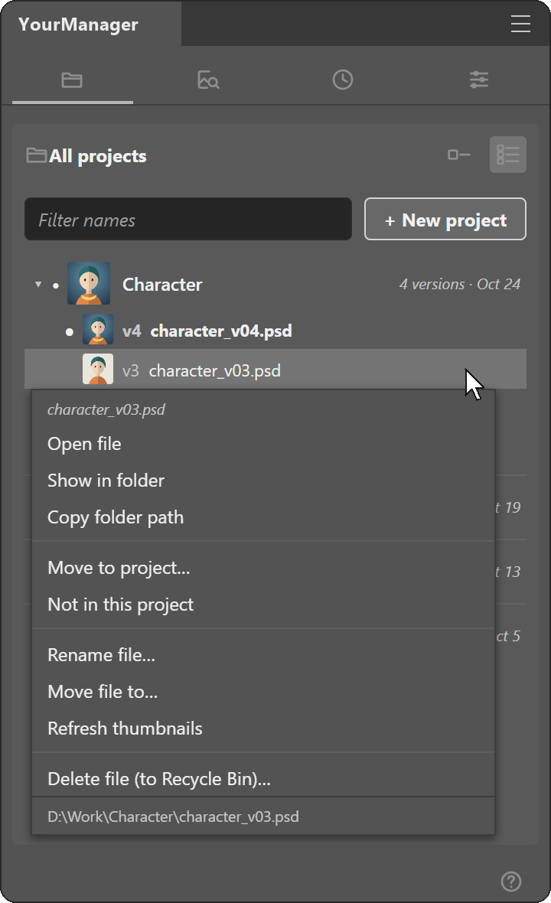

<b>English</b> · <a href="README.vi.md">Tiếng Việt</a>

<h1 align="center">PSArt + YourManager for Photoshop</h1>

Two Photoshop panels for illustrators: PSArt cleans, splits and redraws your artwork; YourManager keeps track of every version of your PSD files.

 

Both run on Windows inside Photoshop 2023 or later. The pictures below come from the plugins' own engines run on test images; panel pictures are marked when they are drawn from a test page instead of a Photoshop screenshot.

## Install

### PSArt 1.5.0

Download: **[PSArt_1.5.0.zip](https://github.com/DanhBoo/psart-plugin/releases/download/v2026.10.25/PSArt_1.5.0.zip)** · [All versions](https://github.com/DanhBoo/psart-plugin/releases)

1. Close Photoshop and delete any older copy in `Plug-ins` ("PSArtCodex", "PSArt Codex" or "PSArt").
2. Right-click the zip > Properties > tick **Unblock** > OK, then extract it.
3. Copy the `PSArt` folder into `C:\Program Files\Adobe\Adobe Photoshop <year>\Plug-ins\` (it must end as `Plug-ins\PSArt\manifest.json`).
4. Open Photoshop > **Plugins** > **PSArt**. When asked about `start_bridge.vbs` (the Codex tab's bridge), tick *Remember my choice* and click **Allow**, or **Deny** if you do not use Codex.

Full install steps: [CAI_DAT_PSArt.txt](CAI_DAT_PSArt.txt)

### YourManager 0.3.2

Download: **[YourManager_0.3.2.zip](https://github.com/DanhBoo/psart-plugin/releases/download/v2026.10.25/YourManager_0.3.2.zip)** · [All versions](https://github.com/DanhBoo/psart-plugin/releases)

1. Close Photoshop. If an older YourManager is in Plug-ins, delete that folder first.
2. Copy the `ptsplugin` folder from the zip into `C:\Program Files\Adobe\Adobe Photoshop <year>\Plug-ins\` (click Continue if Windows asks for admin rights).
3. Open Photoshop > **Plugins** > **YourManager**. The panel is in English; switch in **Settings > Language**.
4. The first time you use Find or Delete, Photoshop asks to run the plugin's .vbs file: click **Allow**. If your antivirus asks about `ym_image_source.exe`, allow it (it runs on this PC only).

Full install steps: [CAI_DAT_YourManager.txt](CAI_DAT_YourManager.txt)

## Requirements

**PSArt**

- Windows 10 / 11
- Photoshop 2023 (24.2) or later
- Codex tab only: the Codex app (or `npm i -g @openai/codex`) signed in with a ChatGPT account. No Node.js needed.

**YourManager**

- Windows 10 / 11
- Photoshop 2023 (24.0) or later
- No Python needed: the Find tab brings its own small program (ym_image_source.exe).

## Features at a glance

| Tool | Tab | What it does |
|---|---|---|
| [Separate to New Layer](#psart-sepcard) | PSArt · Layer Tools | Lasso a part of a painting and lift it onto its own layer, with the hole behind it filled in. |
| [Export & Replace](#psart-replacecard) | PSArt · Layer Tools | Send a layer or selection out as a PNG, edit it anywhere, and drop the result back into the exact same frame. |
| [Extract Lines](#psart-linecard) | PSArt · Lineart | Turn a pixel lineart into clean vector layers that stay sharp at any zoom. |
| [Repair](#psart-repaircard) | PSArt · Lineart | Join broken strokes and smooth wobbly ones, right on your line layer. |
| [Line weight](#psart-weightcard) | PSArt · Lineart | Make lines thinner or thicker in one click, evenly on both sides. |
| [Select](#psart-selectcard) | PSArt · Lineart | Turn a rough lasso into a clean selection that hugs your lines, ready to paint. |
| [Clean AI Image](#psart-cleancard) | PSArt · Clean | Calm the noise of an AI image: steady line color, smooth edges, clean color regions. |
| [Remove background](#psart-bgcard) | PSArt · Clean | Erase a plain background around your subject with a smooth edge, gaps included. |
| [Smooth Color Lines](#psart-cfixcard) | PSArt · Clean | Smooth the lines of a color painting while the colors stay put. |
| [Perspective Grid](#psart-gridcard) | PSArt · Perspective | Draw three or four rough strokes toward a vanishing point and get an even perspective grid. |
| [Redraw on grid](#psart-redrawcard) | PSArt · Perspective | Redraw a loose sketch clean along your perspective grids: straight edges and true perspective circles. |
| [Codex](#psart-codex) | PSArt · Codex | Chat with Codex without leaving Photoshop: send the selection, get images back, drop them in place. |
| [Projects](#ym-projects) | YourManager · Projects | Save as usual - each new version lands on top of its project by itself. |
| [ID inside the file](#ym-file_id) | YourManager · Projects | Rename, copy or move a PSD anywhere - it still knows its project and version. |
| [Find PSD / PSB from image / PSD](#ym-find) | YourManager · Find | Drop an exported JPG or PNG and get the PSD it came from - and the newest version of it. |
| [Action history](#ym-history) | YourManager · History | Changed your mind? Click any step to go back to it. |
| [Settings](#ym-settings) | YourManager · Settings | Choose what gets scanned, the panel language, and reset the data when you need to. |
| [Ask when saving an old version](#ym-save_ask) | YourManager · Settings | Saved an older version? One click moves it to the top. |

## PSArt 1.5.0

**A drawing toolkit in one Photoshop panel: split layers, vector lineart, clean AI images, perspective grids, and Codex chat.**

Every heavy tool runs in the background with its own progress bar, so you can keep painting while it works. Hover any control to see a short Help box right under it.

### Layer Tools

Cut a part of a layer onto its own layer, export / replace images.

panel picture made from a test page, not a screenshot of Photoshop

#### Separate to New Layer

*Lasso a part of a painting and lift it onto its own layer, with the hole behind it filled in.*

The selected part goes to a new layer "… separate" above. The layer underneath gets the hidden area filled with soft colors taken from around it, so you can move, recolor or animate the part without leaving a gap.

**How to use**

1. Pick the painting in **Layer** (empty = the layer selected in the Layers panel).
2. Lasso the part you want on its own layer.
3. Click **Separate to New Layer**.

**Tips & limits**

- The fill is a smooth blend of nearby colors, not a repaint: for large hidden areas, paint over it by hand.
- Runs in the background; the bar at the bottom of the panel shows progress.

#### Export & Replace

*Send a layer or selection out as a PNG, edit it anywhere, and drop the result back into the exact same frame.*

Step 1 exports what the Layers panel points at (a group, a layer, or the whole image), only inside the selection if there is one. Step 2 takes the edited image and fits it into the frame of the exported part, on a new "Edit …" layer.

**How to use**

1. Choose an **Export folder** (gear button).
2. Click **Export** (the button says what it will export).
3. Edit the PNG in any app, then click the box *Click to choose the edited image* and press **Replace**.

**Options**

- **All visible layers** - Export one image of every visible layer, not just the selected one.
- **Transparent / Background** - Keep empty areas transparent, or fill them with the Background color.
- **Stretch to fit** - Stretch the image to the frame; off keeps its proportions.

**Tips & limits**

- Handy for AI editing: export the part, edit it in your AI tool, put it back pixel-aligned.

### Lineart

Redraw raster lines as vector layers, repair breaks, change line weight, select regions.

panel picture made from a test page, not a screenshot of Photoshop

#### Extract Lines

*Turn a pixel lineart into clean vector layers that stay sharp at any zoom.*

Your raster lines are traced into up to 4 vector layers stacked like the original stroke: core, faint, body and edge. Thick-and-thin weight is kept, and small breaks can be closed while tracing.

**How to use**

1. Pick the line layer in **Lineart** (dark lines on light paper).
2. Open **Options** to choose colors, **Close gaps**, and which of the 4 layers to make.
3. Click **Extract Lines**.

**Options**

- **Close gaps** - Also bridge small breaks in the lines.
- **Auto colors** - Take the colors from the lineart itself; off uses the 4 swatches (core, faint, body, edge).

**Tips & limits**

- Runs in the background; when it finishes, click Done on the bar to select the new layers.

#### Repair

*Join broken strokes and smooth wobbly ones, right on your line layer.*

**Join line** bridges a break inside the selection with a curve that follows both line ends. **Smooth Lines** redraws the lines in the selection smooth and even in width; where they leave the selection they stay joined to the rest.

**How to use**

1. Select the line layer in the Layers panel.
2. Lasso the break (Join line) or the wobbly part (Smooth Lines).
3. Click **Join line** or **Smooth Lines**.

**Options**

- **Keep corners** - Sharp bends stay sharp; off rounds them.
- **Strength** - 0 only smooths; higher redraws the lines cleaner; above 20 the curves get simpler and even.

**Tips & limits**

- Join line needs exactly the two line ends inside the selection.

#### Line weight

*Make lines thinner or thicker in one click, evenly on both sides.*

Works on the selected layer(s), inside the selection or on the whole layer. Each click adds up and is one Undo step; thin lines stop at about 1-2 px instead of vanishing.

**How to use**

1. Select the line layer(s); lasso a part if you want only that part.
2. Pick the **Step** (how much one click changes).
3. Click **Thinner** or **Thicker**, as many times as you like.

#### Select

*Turn a rough lasso into a clean selection that hugs your lines, ready to paint.*

Select reads the lineart picked in Extract Lines and selects the regions between the lines that your lasso covers, like a Magic Wand that understands gaps in the lines.

**How to use**

1. Pick the lineart in the **Lineart** box of Extract Lines.
2. Lasso roughly over the areas you want.
3. Click **Select**, then paint on any layer.

**Options**

- **Reach** - How far a lasso reaches. Tight: only what it covers. Wide: whole regions, like Magic Wand.

### Clean

Clean AI images, remove plain backgrounds, smooth painted lines.

panel picture made from a test page, not a screenshot of Photoshop

#### Clean AI Image

*Calm the noise of an AI image: steady line color, smooth edges, clean color regions.*

Cleans the selected image layer, or only the selection. Fuzzy, speckled lines get one steady color and smooth edges; noisy color areas become clean regions while the detail stays.

**How to use**

1. Select the AI image layer (lasso a part to limit it).
2. Choose the line color options if needed.
3. Click **Clean** (one Undo step).

**Options**

- **One line color** - All lines get one color (Auto picks it from the darkest part of the lines, or click the swatch).

#### Remove background

*Erase a plain background around your subject with a smooth edge, gaps included.*

Made for images on a flat or gently graded background (typical AI renders). The background is erased from the layer itself; background seen through closed gaps (between an arm and the body, inside curls) can go too.

**How to use**

1. Select the image layer (lasso to limit it).
2. Leave **Background** on Auto, or pick Light / Dark.
3. Click **Remove** (Ctrl+Z undoes it).

**Options**

- **Remove enclosed gaps** - Also erase background seen through closed gaps.
- **Smooth** - 0 keeps the edge as found; higher is smoother; 2-3 also rounds the corners.

**Tips & limits**

- Pick Light or Dark when the subject touches the image edge a lot.
- Not for busy photo backgrounds.

#### Smooth Color Lines

*Smooth the lines of a color painting while the colors stay put.*

The same smoothing as Smooth Lines, for lines painted into a color image. Nothing is erased; without a selection the whole layer is smoothed.

**How to use**

1. Select the painting layer and lasso the lines to fix.
2. Set **Strength** and **Keep corners**.
3. Click **Smooth**.

### Perspective

Make perspective grids from rough strokes and redraw sketches along them.

panel picture made from a test page, not a screenshot of Photoshop

#### Perspective Grid

*Draw three or four rough strokes toward a vanishing point and get an even perspective grid.*

Your rough guide strokes on the selected layer are fitted to a vanishing point, and an even grid is drawn on a new layer. Straight draws lines to one point; Curved draws arcs through two points.

**How to use**

1. On a new layer, draw a few rough strokes along the perspective.
2. Choose **Type** and **Density**.
3. Click **Make grid**.

**Options**

- **Density** - How many grid lines; changing it redraws the grid layers selected in the Layers panel.

**Tips & limits**

- Run Curved twice, across and down, for 4-point curves.

#### Redraw on grid

*Redraw a loose sketch clean along your perspective grids: straight edges and true perspective circles.*

**Straighten** redraws the lines in the selection straight toward their vanishing points. **Perspective Circle** turns a sketched circle into a clean ellipse that sits on the grid.

**How to use**

1. Add the grid layers to follow (**+ Grid**) and tick the ones to use.
2. Select the sketch layer and lasso the part to redraw.
3. Click **Straighten** or **Perspective Circle**.

**Options**

- **Snap angle** - How far off a grid direction a stroke may be and still snap to it.
- **Rounded corners** - Corners drawn on an arc get a clean arc; off makes every corner sharp.
- **Details follow lines** - Patterns between the lines move with the straightened lines.
- **New layer** - Clean lines go on a layer "<layer> redraw" above; off replaces the sketch.

### Codex

Chat with Codex on this computer; the selection goes along as an image.

panel picture made from a test page, not a screenshot of Photoshop

#### Codex

*Chat with Codex without leaving Photoshop: send the selection, get images back, drop them in place.*

A full chat page in the panel. The selection goes with your message as an image on a new "Edit …" layer; images Codex draws appear in **Images**, and **Replace** puts one back into the selection or the "Edit …" layer. **Line + Base** also asks for a lined-up line art and base color version of each render.

**How to use**

1. Click **Connect** (green dot + email = connected).
2. Select an area if you want it sent, type your message.
3. Press **Send** (Enter only adds a new line); right-click an image Codex made > **Replace**.

**Tips & limits**

- Uses your own ChatGPT account through the Codex app on this PC; the other tabs work without it.

<a href="#top">back to top</a>

## YourManager 0.3.2

**Every version of your PSD files, in one list per project - even after you rename, copy or move them.**

YourManager writes a small project code into each PSD when you save it. Because the code travels inside the file, the panel still knows which project and which version a file is after you rename it in Explorer, copy it to another drive or send it back and forth. It can also find the PSD behind an exported JPG or PNG. Everything stays on your PC.

### Projects

All your projects and their versions, newest on top.

panel picture made from a test page, not a screenshot of Photoshop

#### Projects

*Save as usual - each new version lands on top of its project by itself.*

panel picture made from a test page, not a screenshot of Photoshop

panel picture made from a test page, not a screenshot of Photoshop

Open a PSD and press Ctrl+S: it becomes version 1 of a new project. Save As under a new name and the new file goes right above the one you had open. The project of the file you are working on opens by itself; the open file is bold with a dot. From the list you can open, rename, move or delete files, and Windows Explorer stays in step.

**How to use**

1. Open a PSD and save it (Ctrl+S, Save As or Save a Copy).
2. Keep working and Save As a new name for each new version.
3. In **Projects**, double-click a version to open it, drag rows to reorder, right-click for more.

**Options**

- **Right-click a version** - Open file, Show in folder, Copy folder path, Move to project…, Not in this project, Rename file…, Move file to…, Delete file (to Recycle Bin)…
- **Not in this project** - moves the selected files into a new project instead of mixing them in.
- **+ New project** - an empty project "Project N"; drag versions into it.
- **Picture buttons** - project picture size (Small / Large / Extra large / Off) and a picture on each version. The project picture is the top version.
- **Filter names** - type part of a project or file name.

**Tips & limits**

- Select several rows like layers (Shift / Ctrl), then drag them or press Delete.
- Renaming or moving a file that is open: the plugin asks, saves it, closes it and reopens it in the new place.
- Two copies of one file edited differently are flagged; **Pick the newer one…** sorts them.
- Saves made by scripts or other plugins are not seen by the panel (Photoshop sends no event for them).

#### ID inside the file

*Rename, copy or move a PSD anywhere - it still knows its project and version.*

panel picture made from a test page, not a screenshot of Photoshop

The project code is saved in the PSD itself (in its file info, not in the name). When the panel meets the file again - you open it, or Find scans it - the row follows the new name or place. A copy edited separately becomes its own version.

**How to use**

1. Rename or move a PSD in Windows Explorer as you like.
2. Open it in Photoshop (or **Rescan IDs** in Find).
3. Its row in **Projects** shows the new name, same project, same version.

**Tips & limits**

- Until the panel sees the file again, its row shows "(missing)".
- Files saved before YourManager was installed get their code at their next save.

### Find

Find the PSD behind an image or another PSD.

panel picture made from a test page, not a screenshot of Photoshop

#### Find PSD / PSB from image / PSD

*Drop an exported JPG or PNG and get the PSD it came from - and the newest version of it.*

panel picture made from a test page, not a screenshot of Photoshop

Find reads the IDs of the PSD / PSB files and images in your scan folders once, then looks up any image or PSD you drop in. Results show **Best match** (the PSD that image came from) and **Newest** (the top version of that project). Open one and the panel jumps to it in Projects.

**How to use**

1. In **Find**, click **Scan IDs: PSD / PSB / images** once (later the button becomes **Rescan IDs**).
2. Drop an image or PSD from Explorer on the box (or click it to pick a file).
3. Click **Open** on the question, or the open icon on any result.

**Options**

- **Right-click a result** - open the file, open its folder, copy its path; a file in no project can be added to one.
- **Settings > Folders & file types to scan** - which folders and which kinds of file (PSD / PSB, images, smart objects) are read.

**Tips & limits**

- The first scan takes a few minutes; a rescan takes seconds (about 3 s for ~900 PSD files on the test PC). Moved files are picked up without reading them again.
- Works best on images exported from Photoshop (they keep the ID). An image that lost its ID is matched by how it looks, which is less sure.
- Searching never locks Photoshop: it runs in a separate small program on your PC.

### History

Undo or redo what the plugin did, step by step.

panel picture made from a test page, not a screenshot of Photoshop

#### Action history

*Changed your mind? Click any step to go back to it.*

Every change the plugin makes - reorder, rename, move, project changes - is a row here, newest at the bottom. The last 50 steps are kept.

**How to use**

1. Open **History**.
2. Click a row to go back to right after that step.
3. Click a faded (undone) row to redo it.

**Tips & limits**

- Deleting a file can't be undone here: restore it from the Windows Recycle Bin.

### Settings

Scan folders, file types, save question, language, data reset.

panel picture made from a test page, not a screenshot of Photoshop

#### Settings

*Choose what gets scanned, the panel language, and reset the data when you need to.*

Four sections that fold open: **Folders & file types to scan**, **Notifications**, **Language**, **Data cleanup**.

**Options**

- **Scan folders / Excluded folders** - + / − or drop folders from Explorer. Folders of your projects are always scanned; system and cache folders never.
- **File types to scan** - PSD / PSB, Images (jpg, png, webp, tif, gif), Smart object (off by default; makes the scan 1-3 minutes longer).
- **Ask when saving an old version** - see below.
- **Language** - English or Tiếng Việt, applies at once.
- **Reset data…** - clears old scan data and scans everything again from scratch. Use it when Find gives odd results.

**Tips & limits**

- Project data lives in `%APPDATA%\YourManager`; delete that folder to uninstall completely.

#### Ask when saving an old version

*Saved an older version? One click moves it to the top.*

panel picture made from a test page, not a screenshot of Photoshop

When you save (Ctrl+S, Save As, Save a Copy) a file that is not the top version, the plugin asks **Is this the newest version?**

**How to use**

1. Save a version that is not on top.
2. Click **Yes, move to top** - or **No** to keep the order.

**Tips & limits**

- Tick **Don't ask again** to stop the question; turn it back on in **Settings > Notifications**.

<a href="#top">back to top</a>

## What's new

### PSArt 1.5.0

- Heavy tools (Extract Lines, Separate to New Layer, Join line / Smooth Lines, Clean AI Image, Remove background) run in the background, one bar per task; keep painting meanwhile.

- New layout: icon tabs, one card per tool, and a Help box that opens under whatever you hover (the ? button turns it off).

  

- Clearer names: Layer Tools, Separate to New Layer, Export & Replace, Extract Lines, Smooth Lines, Smooth Color Lines, Curved (2 VP).

- Select moved to the Lineart tab. ([→](#psart-selectcard))

- The Codex tab works like a chat page. ([→](#psart-codex))

- Esc stops a run cleanly; layer boxes remember their layer per file.

### YourManager 0.3.2

- Find no longer needs Python: the image finder ships inside the plugin. ([→](#ym-find))

- Not in this project moves the selected files into a new project. ([→](#ym-projects))

- The project picture follows the top version. ([→](#ym-projects))

- Find results are shorter: one is marked **Best match**, the newest **Newest**. ([→](#ym-find))

  

- Settings > Data cleanup: one **Reset data…** button. ([→](#ym-settings))

## FAQ

<b>Does it work on macOS?</b>

Not yet. Both plugins are built and tested on Windows only.

<b>Is my artwork uploaded anywhere?</b>

PSArt's drawing tools and YourManager work on your PC only. Only the PSArt Codex tab sends something out: the message and the selection you send, to Codex under your own ChatGPT account.

<b>Something went wrong. What should I send?</b>

The line of text at the bottom of the panel, your Photoshop version, and what you clicked.

<b>PSArt asks to run start_bridge.vbs. Is that needed?</b>

Only for the Codex tab. Click Deny if you do not use Codex; the other tabs work normally.

<b>Does YourManager change my PSD files?</b>

It only adds a small project code to the file info (XMP) when you save. Layers and pixels are not touched.

## Contact
This is a test release for friends. Report problems or ideas in [Issues](https://github.com/DanhBoo/psart-plugin/issues) or message the author directly.
