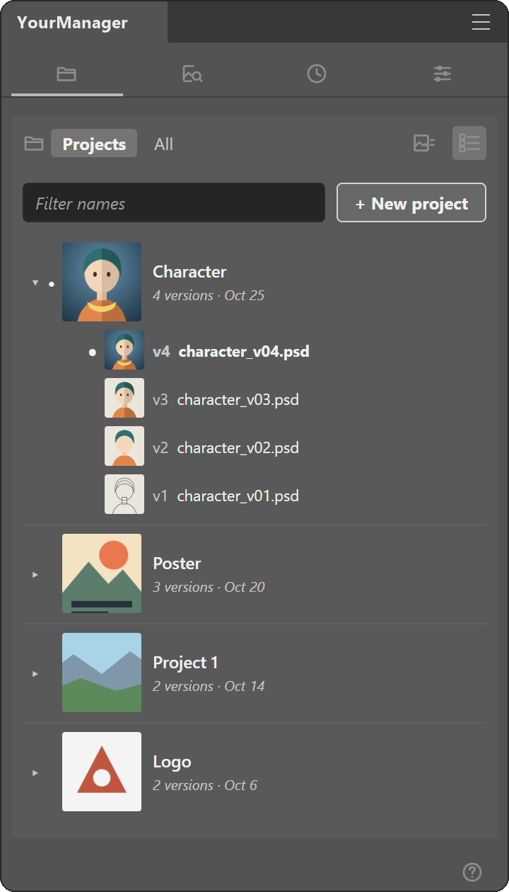
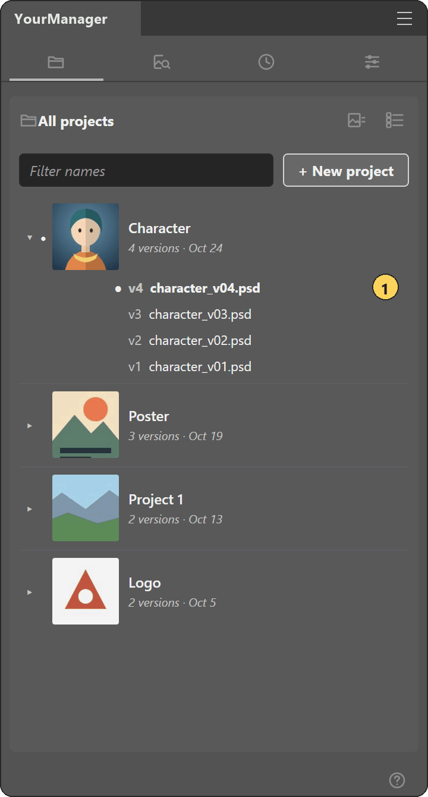
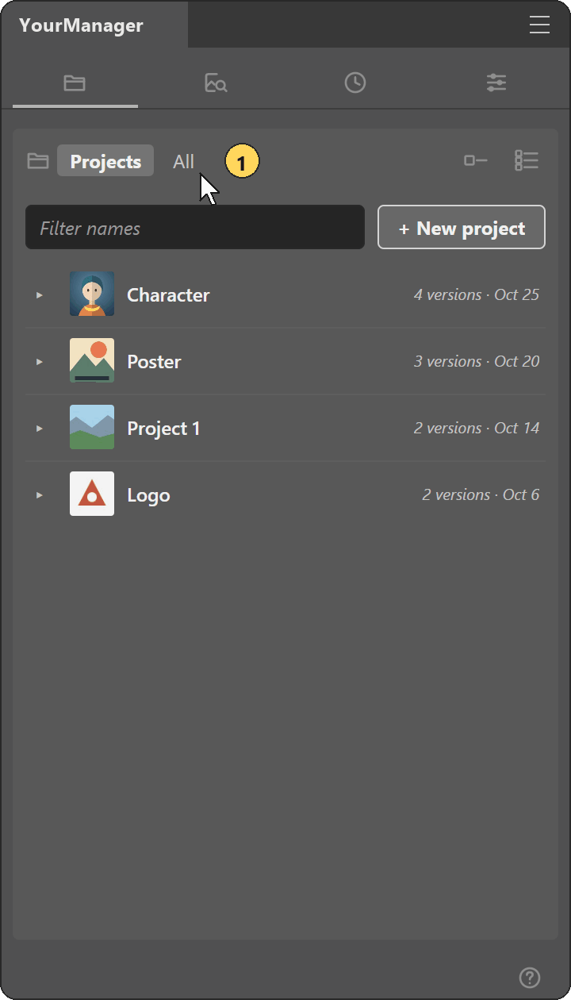
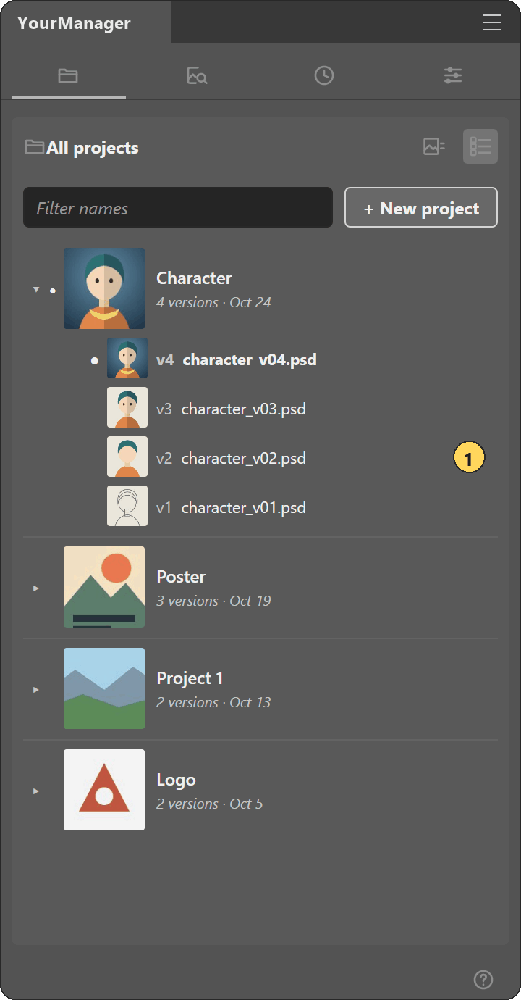
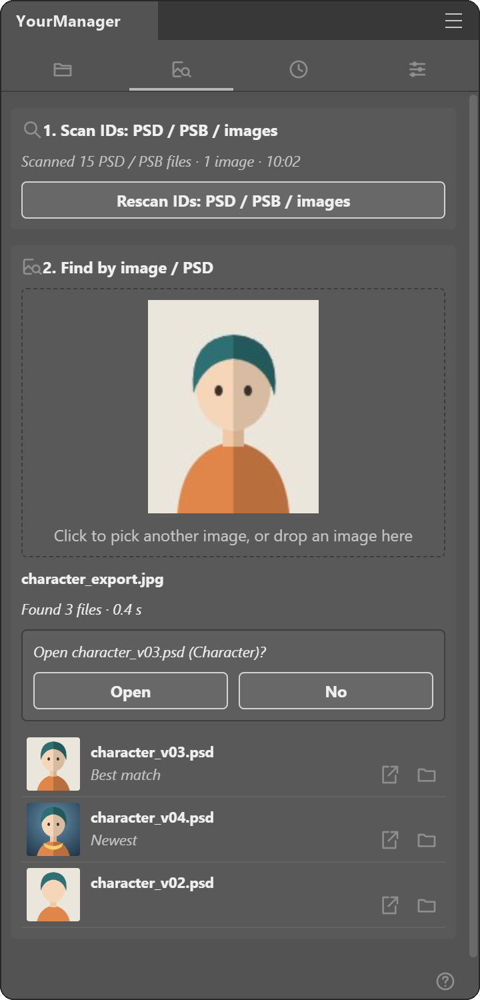
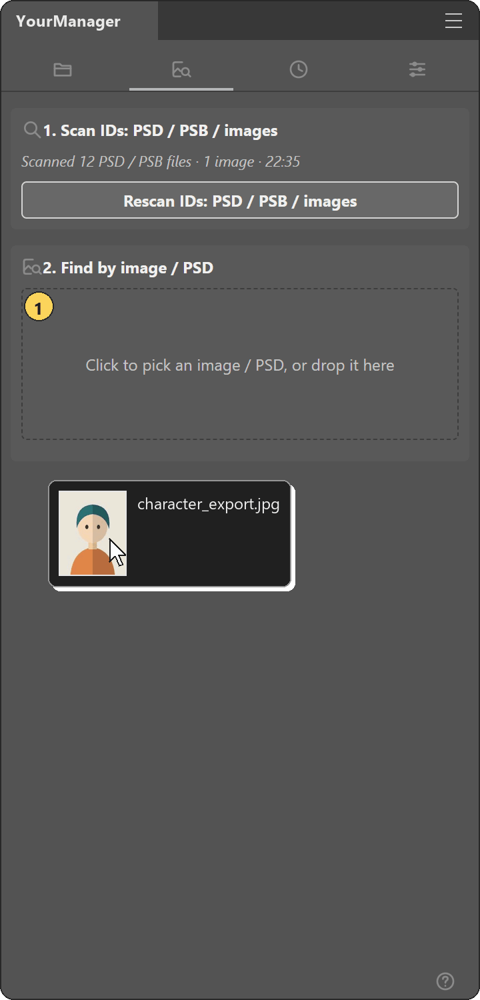
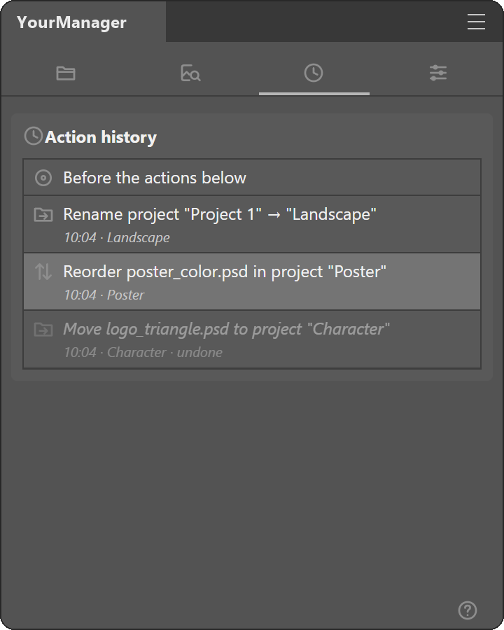
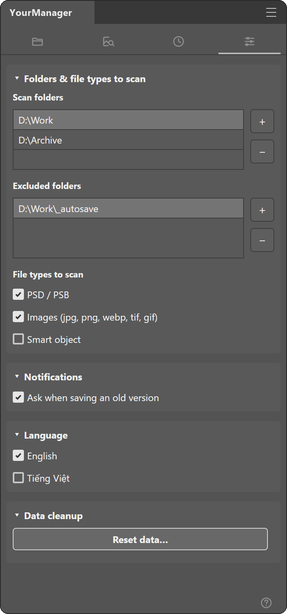
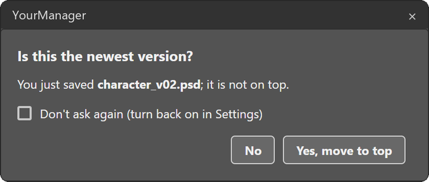

<h1 align="center">PSArt + YourManager for Photoshop</h1>

Photoshop panels for illustrators: PSArt cleans, splits and redraws your art; YourManager tracks every PSD version.

- **Split** a painting into layers in seconds
- **Trace** pixel lineart into sharp vector lines
- **Clean** AI images and remove plain backgrounds
- **Find** the PSD behind any exported image

 

Windows only, Photoshop 2023 or later. Pictures come from the plugins' own engines on test images.

## Install

### PSArt 1.5.2

Download: **[PSArt_1.5.2.zip](https://github.com/DanhBoo/psart-plugin/releases/download/v2026.10.26b/PSArt_1.5.2.zip)** · [All versions](https://github.com/DanhBoo/psart-plugin/releases)

1. Close Photoshop and delete any older copy in `Plug-ins` ("PSArtCodex", "PSArt Codex" or "PSArt").
2. Right-click the zip > Properties > tick **Unblock** > OK, then extract it.
3. Copy the `PSArt` folder into `C:\Program Files\Adobe\Adobe Photoshop <year>\Plug-ins\` (it must end as `Plug-ins\PSArt\manifest.json`).
4. Open Photoshop > **Plugins** > **PSArt**. When asked about `start_bridge.vbs` (the Codex tab's bridge), tick *Remember my choice* and click **Allow**, or **Deny** if you do not use Codex.

Full install steps: [CAI_DAT_PSArt.txt](CAI_DAT_PSArt.txt)

### YourManager 0.4.0

Download: **[YourManager_0.4.0.zip](https://github.com/DanhBoo/psart-plugin/releases/download/v2026.10.26b/YourManager_0.4.0.zip)** · [All versions](https://github.com/DanhBoo/psart-plugin/releases)

1. Close Photoshop; delete any older YourManager in Plug-ins.
2. Copy the `ptsplugin` folder from the zip into `C:\Program Files\Adobe\Adobe Photoshop <year>\Plug-ins\`.
3. Open Photoshop > **Plugins** > **YourManager** (language: **Settings > Language**).
4. Photoshop asks to run a .vbs file on first Find / Delete: click **Allow**.

Full install steps: [CAI_DAT_YourManager.txt](CAI_DAT_YourManager.txt)

## Requirements

**PSArt**

- Windows 10 / 11
- Photoshop 2023 (24.2) or later
- Codex tab only: the Codex app (or `npm i -g @openai/codex`) signed in with a ChatGPT account. No Node.js needed.

**YourManager**

- Windows 10 / 11
- Photoshop 2023 (24.0) or later

## Features at a glance

| Tool | Tab | What it does |
|---|---|---|
| [Separate to New Layer](#psart-sepcard) | PSArt · Layer Tools | Lift a lassoed part onto its own layer; the gap behind it is filled. |
| [Extract Lines](#psart-linecard) | PSArt · Lineart | Turn pixel lineart into vector layers that stay sharp at any zoom. |
| [Repair](#psart-repaircard) | PSArt · Lineart | Join broken strokes and smooth wobbly ones. |
| [Line weight **Beta**](#psart-weightcard) | PSArt · Lineart | Make lines thinner or thicker in one click. |
| [Select](#psart-selectcard) | PSArt · Lineart | Lasso roughly; get a clean selection that hugs your lines. |
| [Clean AI Image **Beta**](#psart-cleancard) | PSArt · Clean | Calm AI image noise: steady line color, smooth edges, clean colors. |
| [Remove background](#psart-bgcard) | PSArt · Clean | Erase a plain background with a smooth edge, gaps included. |
| [Smooth Color Lines **Beta**](#psart-cfixcard) | PSArt · Clean | Smooth the lines of a color painting; colors stay put. |
| [Perspective Grid](#psart-gridcard) | PSArt · Perspective | Draw a few rough strokes; get an even perspective grid. |
| [Redraw on grid](#psart-redrawcard) | PSArt · Perspective | Redraw a loose sketch straight along your grid, with true perspective circles. |
| [Export & Replace](#psart-replacecard) | PSArt · Layer Tools | Export a selection as PNG, edit it anywhere, drop it back in the same frame. |
| [Codex](#psart-codex) | PSArt · Codex | Chat with Codex inside Photoshop; send the selection, drop results back. |
| [Projects](#ym-projects) | YourManager · Projects | Save as usual; each new version lands on top of its project. |
| [Untracked](#ym-untracked) | YourManager · Projects | Every scanned PSD shows up, even outside a project; Track makes it one. |
| [ID inside the file](#ym-file_id) | YourManager · Projects | Rename, copy or move a PSD; it still knows its project and version. |
| [Find PSD / PSB from image / PSD](#ym-find) | YourManager · Find | Drop an exported JPG or PNG; get its PSD and the newest version. |
| [Action history](#ym-history) | YourManager · History | Changed your mind? Click any step to go back. |
| [Settings](#ym-settings) | YourManager · Settings | Choose what gets scanned, the language, and reset data. |
| [Ask when saving an old version](#ym-save_ask) | YourManager · Settings | Saved an older version? One click moves it to the top. |

## PSArt 1.5.2

**One Photoshop panel: split layers, vector lineart, clean AI images, perspective grids, Codex chat.**

Heavy tools run in the background. Hover any control for a short Help box.

### Layer Tools

Cut a part of a layer onto its own layer, export / replace images.

mock-up, not a Photoshop screenshot

#### Separate to New Layer

*Lift a lassoed part onto its own layer; the gap behind it is filled.*

**How to use**

1. Pick the painting in **Layer**.
2. Lasso the part.
3. Click **Separate to New Layer**.

Tips & limits

- The fill blends nearby colors; paint over big hidden areas by hand.

### Lineart

Redraw raster lines as vector layers, repair breaks, change line weight, select regions.

mock-up, not a Photoshop screenshot

#### Extract Lines

*Turn pixel lineart into vector layers that stay sharp at any zoom.*

**How to use**

1. Pick the line layer in **Lineart**.
2. Set **Options** if needed.
3. Click **Extract Lines**.

Options / Tips & limits

**Options**

- **Close gaps** - Also bridge small breaks in the lines.
- **Auto colors** - Take the colors from the lineart itself; off uses the 4 swatches (core, faint, body, edge).

**Tips & limits**

- When it finishes, click Done on the bar to select the new layers.

#### Repair

*Join broken strokes and smooth wobbly ones.*

**How to use**

1. Select the line layer.
2. Lasso the break or the wobbly part.
3. Click **Join line** or **Smooth Lines**.

Options / Tips & limits

**Options**

- **Keep corners** - Sharp bends stay sharp; off rounds them.
- **Strength** - 0 only smooths; higher redraws the lines cleaner; above 20 the curves get simpler and even.

**Tips & limits**

- Join line needs exactly two line ends inside the selection.

#### Line weight <b>Beta</b>

*Make lines thinner or thicker in one click.*

**How to use**

1. Select the line layer(s).
2. Pick the **Step**.
3. Click **Thinner** or **Thicker**.

#### Select

*Lasso roughly; get a clean selection that hugs your lines.*

**How to use**

1. Pick the lineart in Extract Lines.
2. Lasso over the areas.
3. Click **Select**, then paint.

Options

- **Reach** - How far a lasso reaches. Tight: only what it covers. Wide: whole regions, like Magic Wand.

### Clean

Clean AI images, remove plain backgrounds, smooth painted lines.

mock-up, not a Photoshop screenshot

#### Clean AI Image <b>Beta</b>

*Calm AI image noise: steady line color, smooth edges, clean colors.*

**How to use**

1. Select the AI image layer.
2. Set the line color if needed.
3. Click **Clean**.

#### Remove background

*Erase a plain background with a smooth edge, gaps included.*

**How to use**

1. Select the image layer.
2. Leave **Background** on Auto.
3. Click **Remove**.

Options / Tips & limits

**Options**

- **Remove enclosed gaps** - Also erase background seen through closed gaps.
- **Smooth** - 0 keeps the edge as found; higher is smoother; 2-3 also rounds the corners.

**Tips & limits**

- Not for busy photo backgrounds.
- Pick Light or Dark when the subject touches the image edge.

#### Smooth Color Lines <b>Beta</b>

*Smooth the lines of a color painting; colors stay put.*

**How to use**

1. Select the painting; lasso the lines.
2. Set **Strength**.
3. Click **Smooth**.

### Perspective

Make perspective grids from rough strokes and redraw sketches along them.

mock-up, not a Photoshop screenshot

#### Perspective Grid

*Draw a few rough strokes; get an even perspective grid.*

**How to use**

1. Draw rough strokes on a new layer.
2. Choose **Type** and **Density**.
3. Click **Make grid**.

Options / Tips & limits

**Options**

- **Density** - How many grid lines; changing it redraws the grid layers selected in the Layers panel.

**Tips & limits**

- Run Curved twice, across and down, for 4-point curves.

#### Redraw on grid

*Redraw a loose sketch straight along your grid, with true perspective circles.*

**How to use**

1. Add and tick the grids (**+ Grid**).
2. Lasso the sketch part.
3. Click **Straighten** or **Perspective Circle**.

### Edit part of a picture with AI

#### Export & Replace

*Export a selection as PNG, edit it anywhere, drop it back in the same frame.*

**How to use**

1. Choose an **Export folder** (gear button).
2. Click **Export**.
3. Edit the PNG, choose it in the box, press **Replace**.

Options / Tips & limits

**Options**

- **All visible layers** - Export one image of every visible layer, not just the selected one.
- **Transparent / Background** - Keep empty areas transparent, or fill them with the Background color.
- **Stretch to fit** - Stretch the image to the frame; off keeps its proportions.

**Tips & limits**

- Handy for AI editing: the result lands pixel-aligned.

#### Codex

*Chat with Codex inside Photoshop; send the selection, drop results back.*

**How to use**

1. Click **Connect**.
2. Select an area, type your message.
3. Press **Send**; right-click an image > **Replace**.

Tips & limits

- Needs the Codex app signed in with your ChatGPT account; other tabs work without it.

mock-up, not a Photoshop screenshot

<a href="#top">back to top</a>

## YourManager 0.4.0

**Every version of your PSD files in one list per project, even after rename, copy or move.**

A small project code is saved inside each PSD, so the panel still knows the file after you rename or move it. Everything stays on your PC.

### Projects

mock-up, not a Photoshop screenshot

#### Projects

*Save as usual; each new version lands on top of its project.*

mock-up, not a Photoshop screenshot

**How to use**

1. Open a PSD and save it.
2. Save As a new name for each version.
3. In **Projects**, double-click a version to open it.

Options / Tips & limits

**Options**

- **Right-click a version** - Open, show in folder, rename, move, delete (to Recycle Bin).

**Tips & limits**

- Renaming or moving an open file: the plugin saves, closes and reopens it.

#### Untracked

*Every scanned PSD shows up, even outside a project; Track makes it one.*

 All: tree_color under Untracked (grey name) > right-click > Track > it is a project on top" width="360">

mock-up, not a Photoshop screenshot

**How to use**

1. In **Projects**, click **All**.
2. Right-click a group under **Untracked**.
3. Click **Track**: it becomes a project on top.

Tips & limits

- Drag a group onto a project to add it; drag a project onto another to merge.
- **Untrack** on a project sends it back to Untracked.

#### ID inside the file

*Rename, copy or move a PSD; it still knows its project and version.*

mock-up, not a Photoshop screenshot

**How to use**

1. Rename or move a PSD in Explorer.
2. Open it in Photoshop.
3. Its row in **Projects** follows it.

### Find

mock-up, not a Photoshop screenshot

#### Find PSD / PSB from image / PSD

*Drop an exported JPG or PNG; get its PSD and the newest version.*

mock-up, not a Photoshop screenshot

**How to use**

1. Click **Scan IDs: PSD / PSB / images** once.
2. Drop an image or PSD on the box.
3. Click **Open** on a result.

Tips & limits

- Works best on images exported from Photoshop.

### History

mock-up, not a Photoshop screenshot

#### Action history

*Changed your mind? Click any step to go back.*

**How to use**

1. Open **History**.
2. Click a row to go back to it.
3. Click a faded row to redo.

### Settings

mock-up, not a Photoshop screenshot

#### Settings

*Choose what gets scanned, the language, and reset data.*

**How to use**

1. Open **Settings**.
2. Add scan folders; pick file types.
3. Pick the language.

Tips & limits

- Delete `%APPDATA%\YourManager` to uninstall completely.

#### Ask when saving an old version

*Saved an older version? One click moves it to the top.*

mock-up, not a Photoshop screenshot

**How to use**

1. Save a version that is not on top.
2. Click **Yes, move to top** or **No**.

Tips & limits

- Turn the question back on in **Settings > Notifications**.

<a href="#top">back to top</a>

## What's new

### PSArt 1.5.2

- Join line follows the line across a dashed gap instead of jumping to a nearby line. ([→](#psart-repaircard))

- A closed or collapsed panel does nothing in the background.

### YourManager 0.4.0

- Newest project on top: projects are sorted by the day they were created. ([→](#ym-projects))

- **All** also lists **Untracked**: scanned files in no project, grouped by source file. **Track** makes one a project. ([→](#ym-untracked))

   All > Untracked > Track" width="480">

- Drag a group or file onto a project to add it; drag a project onto another to merge. ([→](#ym-untracked))

- **Not in this project** and **Untrack** send files back to Untracked (undo in History). ([→](#ym-projects))

- Find: opening a file that is in no project makes it a project on top, with its whole group. ([→](#ym-find))

## FAQ

<b>Does it work on macOS?</b>

Not yet. Both plugins are built and tested on Windows only.

<b>Is my artwork uploaded anywhere?</b>

PSArt's drawing tools and YourManager work on your PC only. Only the PSArt Codex tab sends something out: the message and the selection you send, to Codex under your own ChatGPT account.

<b>Something went wrong. What should I send?</b>

The line of text at the bottom of the panel, your Photoshop version, and what you clicked.

<b>PSArt asks to run start_bridge.vbs. Is that needed?</b>

Only for the Codex tab. Click Deny if you do not use Codex; the other tabs work normally.

<b>Does YourManager change my PSD files?</b>

It only adds a small project code to the file info (XMP) when you save. Layers and pixels are not touched.

## Contact
This is a test release for friends. Report problems or ideas in [Issues](https://github.com/DanhBoo/psart-plugin/issues) or message the author directly.
