
<b>Tiếng Việt</b> · <a href="README.md">English</a>

<h1 align="center">PSArt + YourManager cho Photoshop</h1>

Hai panel Photoshop cho người vẽ: PSArt làm sạch, tách layer và vẽ lại nét cho bạn; YourManager theo dõi mọi version của file PSD.

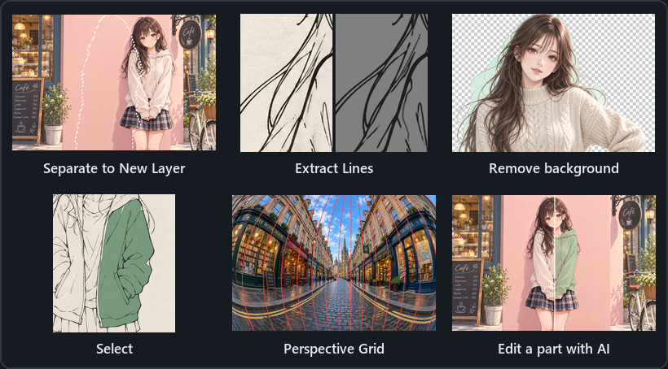

 

Cả hai chạy trên Windows, trong Photoshop 2023 trở lên. Hình minh hoạ bên dưới là kết quả thật của chính các công cụ chạy trên ảnh thử; ảnh panel nào dựng từ trang thử (không phải ảnh chụp Photoshop) đều có ghi chú.

## Cài đặt

### PSArt 1.5.0

Tải: **[PSArt_1.5.0.zip](https://github.com/DanhBoo/psart-plugin/releases/download/v2026.10.25/PSArt_1.5.0.zip)** · [Mọi phiên bản](https://github.com/DanhBoo/psart-plugin/releases)

1. Tắt Photoshop, xoá bản cũ trong `Plug-ins` ("PSArtCodex", "PSArt Codex" hoặc "PSArt").
2. Chuột phải file zip > Properties > tick **Unblock** > OK, rồi giải nén.
3. Chép thư mục `PSArt` vào `C:\Program Files\Adobe\Adobe Photoshop <năm>\Plug-ins\` (đúng là `Plug-ins\PSArt\manifest.json`).
4. Mở Photoshop > **Plugins** > **PSArt**. Hộp hỏi quyền `start_bridge.vbs` (chương trình nối của tab Codex): tick *Remember my choice* rồi bấm **Allow**; không dùng Codex thì bấm **Deny** cũng được.

Hướng dẫn cài đầy đủ: [CAI_DAT_PSArt.txt](CAI_DAT_PSArt.txt)

### YourManager 0.3.2

Tải: **[YourManager_0.3.2.zip](https://github.com/DanhBoo/psart-plugin/releases/download/v2026.10.25/YourManager_0.3.2.zip)** · [Mọi phiên bản](https://github.com/DanhBoo/psart-plugin/releases)

1. Tắt Photoshop. Đã có bản YourManager cũ trong Plug-ins thì xoá thư mục đó trước.
2. Chép thư mục `ptsplugin` trong zip vào `C:\Program Files\Adobe\Adobe Photoshop <năm>\Plug-ins\` (Windows hỏi quyền admin thì bấm Continue).
3. Mở Photoshop > **Plugins** > **YourManager**. Panel mặc định tiếng Anh; đổi ở **Settings > Language** (chọn Tiếng Việt).
4. Lần đầu dùng Tìm hoặc Xoá file, Photoshop hỏi quyền chạy file .vbs của plugin: bấm **Allow**. Phần mềm diệt virus hỏi về `ym_image_source.exe` thì cho phép (chỉ chạy trên máy).

Hướng dẫn cài đầy đủ: [CAI_DAT_YourManager.txt](CAI_DAT_YourManager.txt)

## Yêu cầu hệ thống

**PSArt**

- Windows 10 / 11
- Photoshop 2023 (bản 24.2) trở lên
- Riêng tab Codex: Codex đã cài (app Codex hoặc `npm i -g @openai/codex`) và đăng nhập bằng tài khoản ChatGPT. Không cần Node.js.

**YourManager**

- Windows 10 / 11
- Photoshop 2023 (bản 24.0) trở lên
- Không cần Python: tab Tìm có sẵn chương trình riêng (ym_image_source.exe).

## Tính năng tóm tắt

| Công cụ | Tab | Làm gì |
|---|---|---|
| [Separate to New Layer](#psart-sepcard) | PSArt · Layer Tools | Khoanh một phần tranh, nhấc nó lên layer riêng, chỗ trống phía sau được tự lấp. |
| [Export & Replace](#psart-replacecard) | PSArt · Layer Tools | Xuất một layer hoặc vùng chọn ra PNG, sửa ở đâu cũng được, rồi đưa ảnh đã sửa về đúng khung cũ. |
| [Extract Lines](#psart-linecard) | PSArt · Lineart | Biến lineart pixel thành các layer vector sạch, phóng to bao nhiêu cũng nét. |
| [Repair](#psart-repaircard) | PSArt · Lineart | Nối nét đứt và làm mượt nét run, ngay trên layer nét của bạn. |
| [Line weight](#psart-weightcard) | PSArt · Lineart | Làm nét mảnh hơn hoặc dày hơn chỉ bằng một cú bấm, đều cả hai bên. |
| [Select](#psart-selectcard) | PSArt · Lineart | Biến một vòng khoanh ẩu thành vùng chọn sạch ôm sát nét, tô màu được ngay. |
| [Clean AI Image](#psart-cleancard) | PSArt · Clean | Dẹp nhiễu của ảnh AI: màu nét ổn định, mép mượt, mảng màu sạch. |
| [Remove background](#psart-bgcard) | PSArt · Clean | Xoá nền trơn quanh chủ thể với mép mượt, kể cả nền lọt giữa các khe. |
| [Smooth Color Lines](#psart-cfixcard) | PSArt · Clean | Làm mượt nét của tranh màu mà màu vẫn giữ nguyên. |
| [Perspective Grid](#psart-gridcard) | PSArt · Perspective | Vẽ vài nét nháp hướng về điểm tụ là có ngay lưới phối cảnh đều đặn. |
| [Redraw on grid](#psart-redrawcard) | PSArt · Perspective | Vẽ lại bản phác ẩu cho sạch theo lưới phối cảnh: cạnh thẳng và hình tròn đúng phối cảnh. |
| [Codex](#psart-codex) | PSArt · Codex | Chat với Codex không cần rời Photoshop: gửi vùng chọn, nhận ảnh về, thả đúng chỗ. |
| [Dự án](#ym-projects) | YourManager · Dự án | Cứ lưu như thường - version mới tự nằm trên cùng dự án của nó. |
| [ID nằm trong file](#ym-file_id) | YourManager · Dự án | Đổi tên, chép hay dời PSD đi đâu - file vẫn nhớ dự án và version của nó. |
| [Tìm PSD / PSB dự án từ ảnh / PSD](#ym-find) | YourManager · Tìm | Thả một ảnh JPG / PNG đã xuất, ra ngay file PSD gốc - và version mới nhất của nó. |
| [Lịch sử thao tác](#ym-history) | YourManager · Lịch sử | Đổi ý? Bấm một bước bất kỳ để quay về đó. |
| [Cài đặt](#ym-settings) | YourManager · Cài đặt | Chọn quét gì, ngôn ngữ panel, và làm mới dữ liệu khi cần. |
| [Hỏi khi lưu version cũ](#ym-save_ask) | YourManager · Cài đặt | Vừa lưu một version cũ? Một cú bấm là đưa nó lên trên cùng. |

## PSArt 1.5.0

**Bộ công cụ vẽ gói trong một panel Photoshop: tách layer, lineart vector, làm sạch ảnh AI, lưới phối cảnh và chat Codex.**

Công cụ nặng đều chạy ngầm, mỗi việc một thanh tiến trình riêng, trong lúc đó bạn vẫn vẽ tiếp được. Rê chuột lên bất kỳ nút nào là có ô Help ngắn hiện ngay bên dưới.

### Layer Tools

Tách một phần layer ra layer riêng, xuất ảnh đi sửa rồi thay lại vào file.

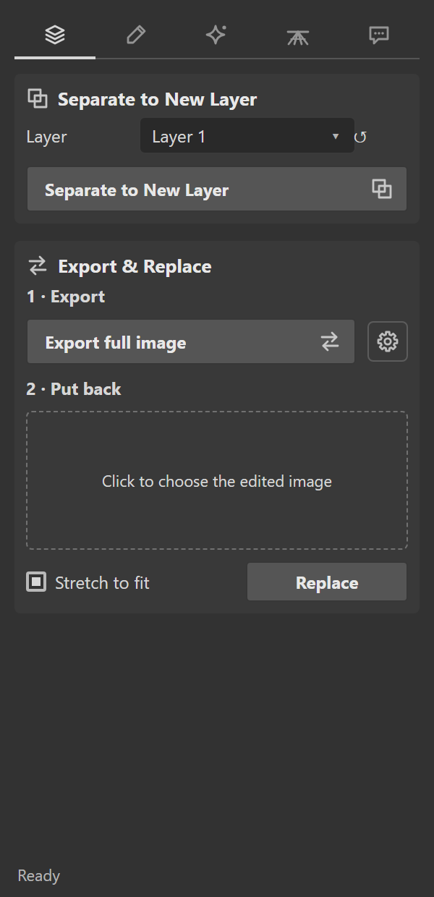

ảnh panel dựng từ trang thử, không phải ảnh chụp Photoshop

#### Separate to New Layer

*Khoanh một phần tranh, nhấc nó lên layer riêng, chỗ trống phía sau được tự lấp.*

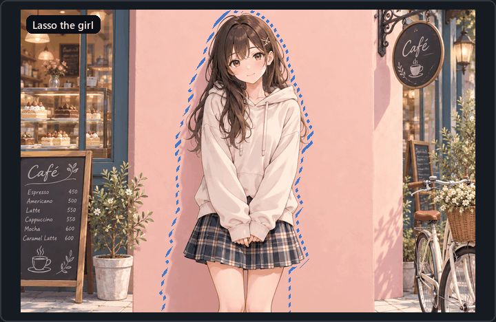

Phần được khoanh sang layer mới "… separate" ở trên. Layer bên dưới được lấp vùng bị che bằng màu dịu lấy từ xung quanh, nên dời, đổi màu hay làm chuyển động phần đó không để lại lỗ trống.

**Cách dùng**

1. Chọn layer tranh ở ô **Layer** (để trống = layer đang chọn trong bảng Layers).
2. Khoanh vùng phần muốn tách.
3. Bấm **Separate to New Layer**.

**Mẹo & giới hạn**

- Phần lấp là màu chuyển dịu từ màu xung quanh, không vẽ lại chi tiết: vùng bị che lớn thì vẽ tay thêm.
- Chạy ngầm; thanh ở cuối panel cho biết tiến độ.

#### Export & Replace

*Xuất một layer hoặc vùng chọn ra PNG, sửa ở đâu cũng được, rồi đưa ảnh đã sửa về đúng khung cũ.*

Bước 1 xuất đúng thứ đang chọn trong bảng Layers (group, layer hay cả ảnh), có vùng chọn thì chỉ phần trong vùng chọn. Bước 2 lấy ảnh đã sửa, đặt khít vào khung của phần đã xuất, trên layer mới "Edit …".

**Cách dùng**

1. Chọn **Export folder** (nút bánh răng).
2. Bấm **Export** (tên nút nói rõ sẽ xuất gì).
3. Sửa file PNG bằng app nào cũng được, rồi bấm ô *Click to choose the edited image* và bấm **Replace**.

**Tuỳ chọn**

- **All visible layers** - Xuất một ảnh gộp mọi layer đang hiện, không chỉ layer đang chọn.
- **Transparent / Background** - Giữ vùng trống trong suốt, hoặc tô bằng màu Background.
- **Stretch to fit** - Kéo giãn ảnh cho khít khung; tắt thì giữ tỉ lệ.

**Mẹo & giới hạn**

- Tiện khi sửa bằng AI: xuất phần cần sửa, sửa bằng công cụ AI, đưa về khớp từng pixel.

### Lineart

Vẽ lại nét raster thành layer vector, nối / làm mượt nét, đổi độ dày nét, chọn vùng giữa các nét.

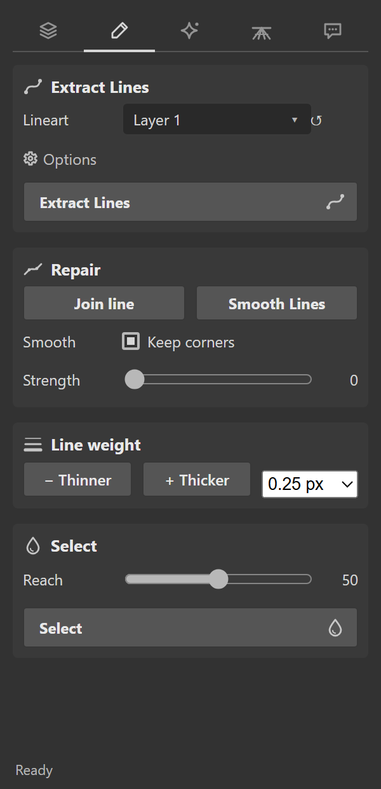

ảnh panel dựng từ trang thử, không phải ảnh chụp Photoshop

#### Extract Lines

*Biến lineart pixel thành các layer vector sạch, phóng to bao nhiêu cũng nét.*

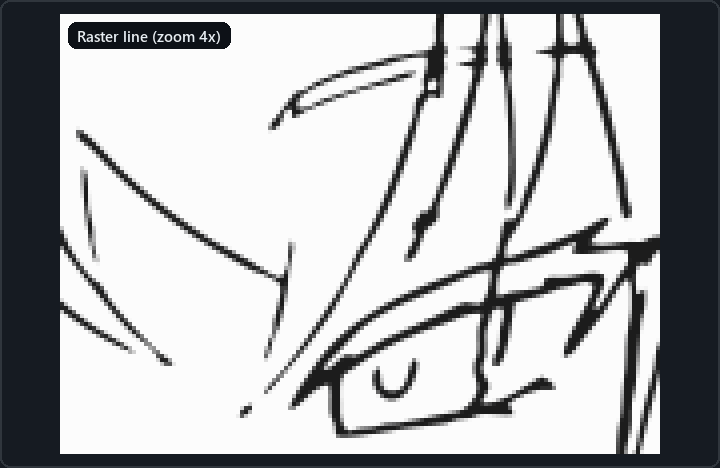

Nét raster được dò lại thành tối đa 4 layer vector xếp chồng như nét gốc: core, faint, body, edge. Nét đậm nhạt được giữ, các chỗ đứt nhỏ có thể được nối luôn khi dò.

**Cách dùng**

1. Chọn layer nét ở ô **Lineart** (nét tối trên nền sáng).
2. Mở **Options** để chọn màu, **Close gaps** và layer nào trong 4 layer sẽ tạo.
3. Bấm **Extract Lines**.

**Tuỳ chọn**

- **Close gaps** - Nối luôn các chỗ đứt nhỏ trên nét.
- **Auto colors** - Lấy màu từ chính lineart; tắt thì dùng 4 ô màu (core, faint, body, edge).

**Mẹo & giới hạn**

- Chạy ngầm; xong thì bấm Done trên thanh để chọn các layer mới.

#### Repair

*Nối nét đứt và làm mượt nét run, ngay trên layer nét của bạn.*

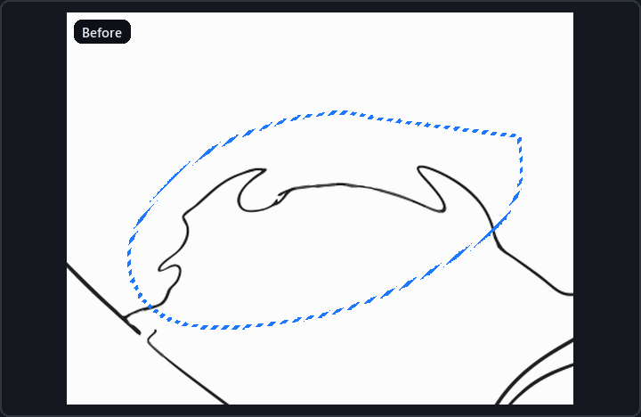

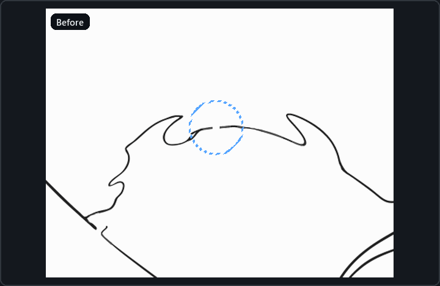

**Join line** nối chỗ đứt trong vùng chọn bằng một đường cong đi theo hai đầu nét. **Smooth Lines** vẽ lại các nét trong vùng chọn cho mượt, đều độ dày; chỗ nét đi ra ngoài vùng chọn vẫn liền với phần còn lại.

**Cách dùng**

1. Chọn layer nét trong bảng Layers.
2. Khoanh chỗ đứt (Join line) hoặc đoạn nét run (Smooth Lines).
3. Bấm **Join line** hoặc **Smooth Lines**.

**Tuỳ chọn**

- **Keep corners** - Góc gắt giữ nguyên; tắt thì bo tròn.
- **Strength** - 0 chỉ làm mượt; cao hơn vẽ lại nét sạch hơn; trên 20 đường cong đơn giản và đều hơn.

**Mẹo & giới hạn**

- Join line cần đúng hai đầu nét nằm trong vùng chọn.

#### Line weight

*Làm nét mảnh hơn hoặc dày hơn chỉ bằng một cú bấm, đều cả hai bên.*

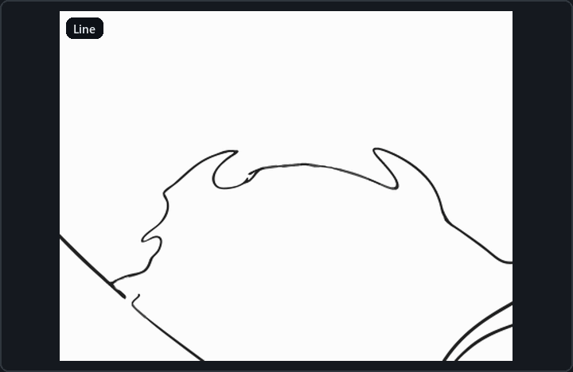

Áp lên layer đang chọn, trong vùng chọn hoặc cả layer. Mỗi lần bấm cộng dồn và là một bước Undo; nét mảnh dừng ở khoảng 1-2 px chứ không biến mất.

**Cách dùng**

1. Chọn layer nét; khoanh một phần nếu chỉ muốn đổi phần đó.
2. Chọn **Step** (mỗi lần bấm đổi bao nhiêu).
3. Bấm **Thinner** hoặc **Thicker**, bao nhiêu lần tuỳ ý.

#### Select

*Biến một vòng khoanh ẩu thành vùng chọn sạch ôm sát nét, tô màu được ngay.*

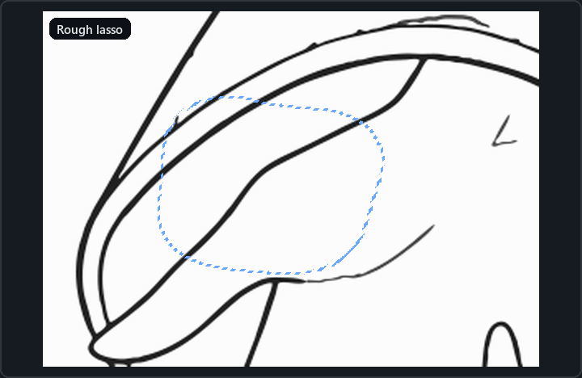

Select đọc lineart đang chọn ở Extract Lines và chọn các vùng giữa nét mà vòng khoanh phủ lên, giống Magic Wand nhưng hiểu cả chỗ nét hở.

**Cách dùng**

1. Chọn lineart ở ô **Lineart** của Extract Lines.
2. Khoanh đại khái lên các vùng muốn chọn.
3. Bấm **Select**, rồi tô trên layer nào cũng được.

**Tuỳ chọn**

- **Reach** - Vòng khoanh lấy tới đâu. Tight: chỉ phần được phủ. Wide: cả vùng, như Magic Wand.

### Clean

Làm sạch ảnh AI, xoá nền trơn, làm mượt nét trên tranh màu.

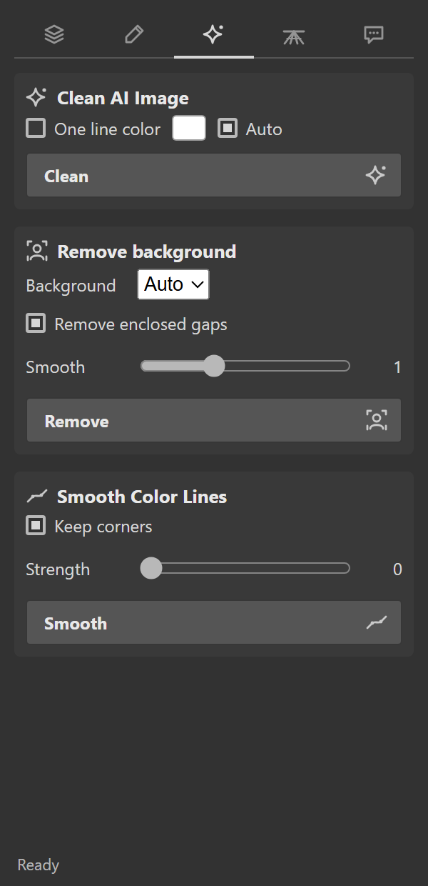

ảnh panel dựng từ trang thử, không phải ảnh chụp Photoshop

#### Clean AI Image

*Dẹp nhiễu của ảnh AI: màu nét ổn định, mép mượt, mảng màu sạch.*

Làm sạch layer ảnh đang chọn, hoặc chỉ trong vùng chọn. Nét nhoè lấm tấm được về một màu ổn định, mép mượt; mảng màu nhiễu thành vùng màu sạch mà vẫn giữ chi tiết.

**Cách dùng**

1. Chọn layer ảnh AI (khoanh vùng nếu chỉ muốn làm một phần).
2. Chỉnh màu nét nếu cần.
3. Bấm **Clean** (một bước Undo).

**Tuỳ chọn**

- **One line color** - Mọi nét cùng một màu (Auto lấy từ phần tối nhất của nét, hoặc bấm ô màu để chọn).

#### Remove background

*Xoá nền trơn quanh chủ thể với mép mượt, kể cả nền lọt giữa các khe.*

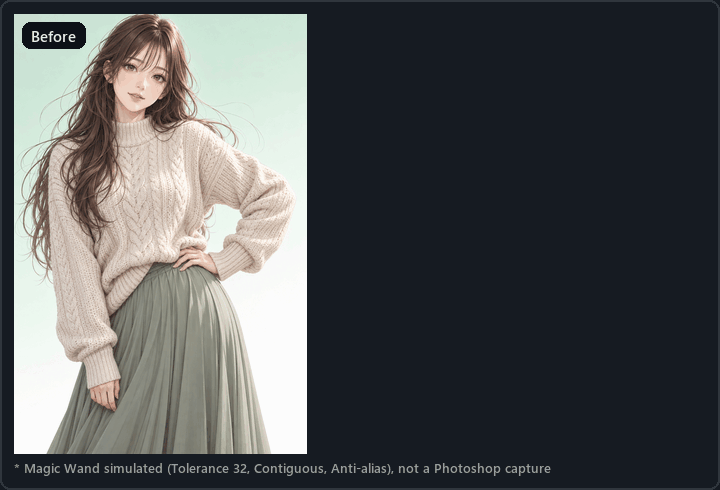

Dành cho ảnh trên nền trơn hoặc chuyển màu nhẹ (thường gặp ở ảnh AI). Nền bị xoá ngay trên layer; phần nền lọt qua các khe kín (giữa tay và thân, trong lọn tóc) cũng xoá được.

**Cách dùng**

1. Chọn layer ảnh (khoanh vùng để giới hạn).
2. Để **Background** ở Auto, hoặc chọn Light / Dark.
3. Bấm **Remove** (Ctrl+Z để hoàn tác).

**Tuỳ chọn**

- **Remove enclosed gaps** - Xoá cả phần nền lọt qua các khe kín.
- **Smooth** - 0 giữ mép như cũ; cao hơn thì mượt hơn; 2-3 bo cả góc.

**Mẹo & giới hạn**

- Chủ thể chạm mép ảnh nhiều thì chọn Light hoặc Dark.
- Không dành cho nền ảnh chụp nhiều chi tiết.

#### Smooth Color Lines

*Làm mượt nét của tranh màu mà màu vẫn giữ nguyên.*

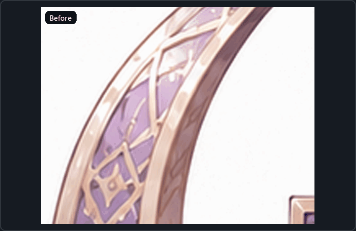

Cùng kiểu làm mượt như Smooth Lines, dành cho nét nằm trong tranh màu. Không xoá gì; không có vùng chọn thì làm cả layer.

**Cách dùng**

1. Chọn layer tranh, khoanh các nét cần sửa.
2. Chỉnh **Strength** và **Keep corners**.
3. Bấm **Smooth**.

### Perspective

Dựng lưới phối cảnh từ vài nét nháp và vẽ lại bản phác theo lưới.

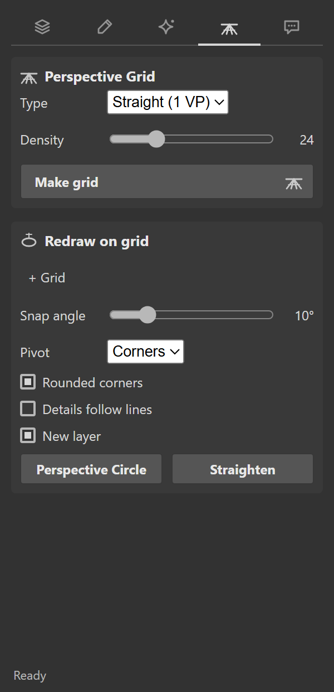

ảnh panel dựng từ trang thử, không phải ảnh chụp Photoshop

#### Perspective Grid

*Vẽ vài nét nháp hướng về điểm tụ là có ngay lưới phối cảnh đều đặn.*

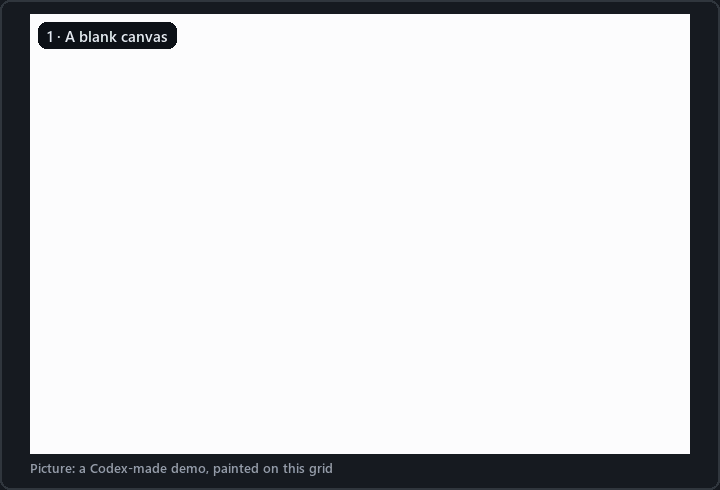

Các nét dẫn nháp trên layer đang chọn được tính ra điểm tụ, rồi vẽ lưới đều lên một layer mới. Straight vẽ đường thẳng về một điểm; Curved vẽ cung tròn qua hai điểm.

**Cách dùng**

1. Trên một layer mới, vẽ vài nét nháp theo phối cảnh.
2. Chọn **Type** và **Density**.
3. Bấm **Make grid**.

**Tuỳ chọn**

- **Density** - Số đường lưới; đổi là vẽ lại các layer lưới đang chọn trong bảng Layers.

**Mẹo & giới hạn**

- Chạy Curved hai lần, theo ngang và dọc, để có lưới cong 4 điểm.

#### Redraw on grid

*Vẽ lại bản phác ẩu cho sạch theo lưới phối cảnh: cạnh thẳng và hình tròn đúng phối cảnh.*

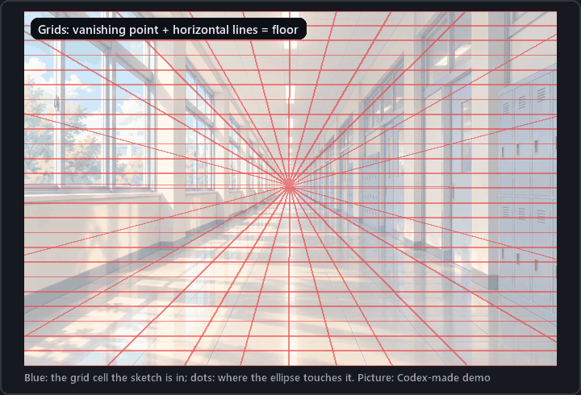

**Straighten** vẽ lại các nét trong vùng chọn thành đường thẳng về đúng điểm tụ. **Perspective Circle** biến vòng tròn phác thành elip sạch nằm đúng trên lưới.

**Cách dùng**

1. Thêm các layer lưới cần bám (**+ Grid**) và tick lưới muốn dùng.
2. Chọn layer phác, khoanh phần cần vẽ lại.
3. Bấm **Straighten** hoặc **Perspective Circle**.

**Tuỳ chọn**

- **Snap angle** - Nét lệch hướng lưới bao nhiêu độ thì vẫn được nắn về lưới.
- **Rounded corners** - Góc vẽ bo được bo sạch; tắt thì mọi góc vuông gắt.
- **Details follow lines** - Hoa văn giữa các đường dời theo đường đã nắn.
- **New layer** - Nét sạch nằm trên layer "<layer> redraw" phía trên; tắt thì thay luôn bản phác.

### Codex

Chat với Codex ngay trong Photoshop; vùng chọn được gửi kèm thành ảnh.

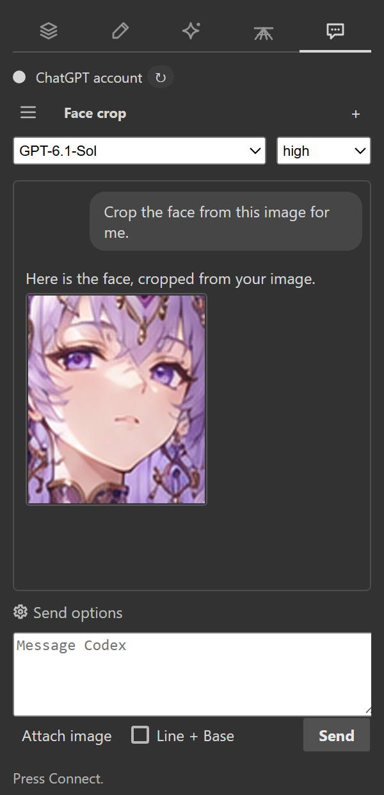

ảnh panel dựng từ trang thử, không phải ảnh chụp Photoshop

#### Codex

*Chat với Codex không cần rời Photoshop: gửi vùng chọn, nhận ảnh về, thả đúng chỗ.*

Một trang chat đầy đủ trong panel. Vùng chọn được gửi kèm tin nhắn thành ảnh, trên layer mới "Edit …"; ảnh Codex vẽ hiện ở **Images**, bấm **Replace** để đưa ảnh về vùng chọn hoặc layer "Edit …". **Line + Base** xin thêm bản line art và bản màu nền khớp với mỗi ảnh.

**Cách dùng**

1. Bấm **Connect** (chấm xanh + email = đã nối).
2. Chọn vùng nếu muốn gửi kèm, gõ tin nhắn.
3. Bấm **Send** (Enter chỉ xuống dòng); chuột phải ảnh Codex vẽ > **Replace**.

**Mẹo & giới hạn**

- Dùng tài khoản ChatGPT của chính bạn qua Codex trên máy; các tab khác không cần Codex.

<a href="#top">lên đầu trang</a>

## YourManager 0.3.2

**Mọi version của file PSD, gọn trong một danh sách theo dự án - đổi tên, chép hay dời file vẫn nhận ra.**

YourManager ghi một mã dự án nhỏ vào trong mỗi file PSD lúc bạn lưu. Mã nằm trong chính file, nên đổi tên trong Explorer, chép sang ổ khác hay gửi qua lại thì panel vẫn biết file đó thuộc dự án nào, version mấy. Nó còn tìm ra file PSD gốc của một ảnh JPG / PNG đã xuất. Mọi thứ chỉ chạy trên máy bạn.

### Dự án

Mọi dự án và các version, mới nhất ở trên cùng.

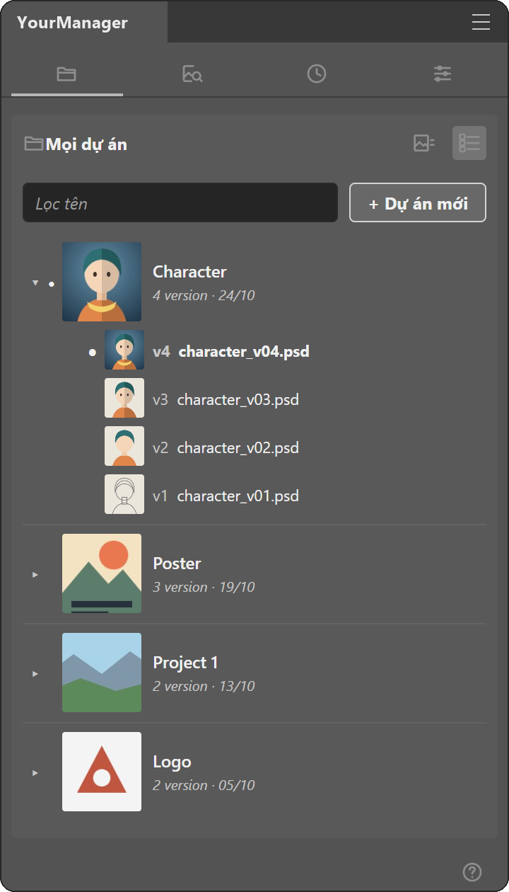

ảnh panel dựng từ trang thử, không phải ảnh chụp Photoshop

#### Dự án

*Cứ lưu như thường - version mới tự nằm trên cùng dự án của nó.*

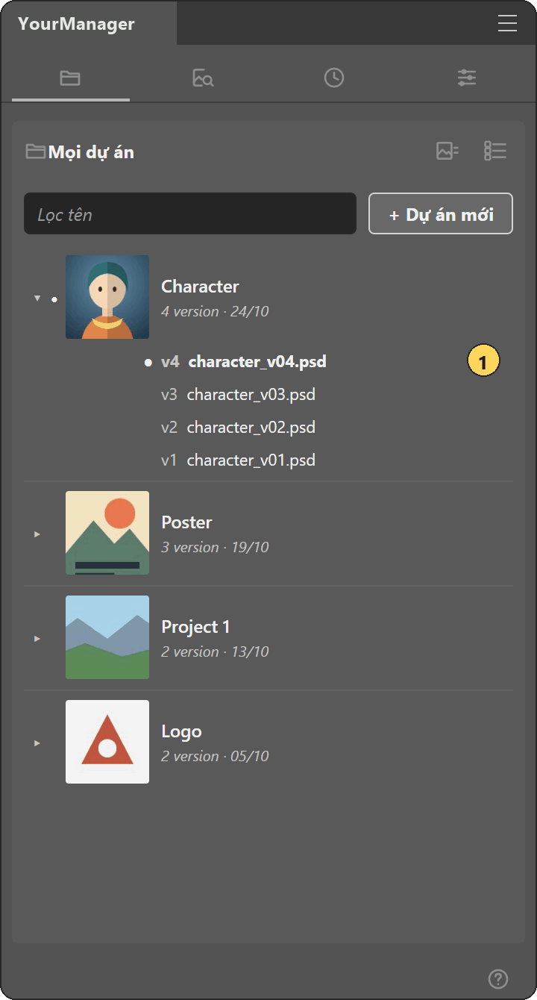

ảnh panel dựng từ trang thử, không phải ảnh chụp Photoshop

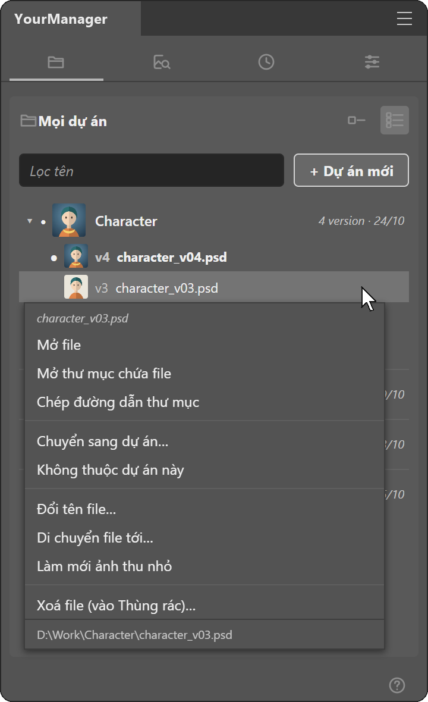

ảnh panel dựng từ trang thử, không phải ảnh chụp Photoshop

Mở một PSD rồi Ctrl+S: file thành version 1 của một dự án mới. Save As sang tên mới thì file mới nằm ngay trên file đang mở. Dự án của file đang làm tự xổ ra; file đang mở in đậm, có chấm. Ngay trong list có thể mở, đổi tên, dời hay xoá file, Windows Explorer đổi theo.

**Cách dùng**

1. Mở một PSD và lưu (Ctrl+S, Save As hoặc Save a Copy).
2. Làm tiếp, mỗi version mới thì Save As sang tên mới.
3. Ở **Dự án**: nhấp đúp một version để mở, kéo dòng để xếp lại, chuột phải để có thêm lệnh.

**Tuỳ chọn**

- **Chuột phải một version** - Mở file, Mở thư mục chứa file, Chép đường dẫn thư mục, Chuyển sang dự án…, Không thuộc dự án này, Đổi tên file…, Di chuyển file tới…, Xoá file (vào Thùng rác)…
- **Không thuộc dự án này** - chuyển các file đang chọn sang một dự án mới, không để lẫn vào dự án này.
- **+ Dự án mới** - dự án trống "Project N"; kéo version vào.
- **Nút ảnh** - cỡ ảnh dự án (Nhỏ / Lớn / Rất lớn / Tắt) và ảnh trên từng version. Ảnh dự án là ảnh của version trên cùng.
- **Lọc tên** - gõ một phần tên dự án hoặc tên file.

**Mẹo & giới hạn**

- Chọn nhiều dòng như layer (Shift / Ctrl), rồi kéo hoặc bấm Delete.
- Đổi tên / dời file đang mở: plugin hỏi, lưu, đóng rồi mở lại ở chỗ mới.
- Hai bản chép của cùng một file đã sửa khác nhau được đánh dấu; **Chọn bản mới hơn…** để xếp.
- Lần lưu do script hay plugin khác thực hiện thì panel không thấy (Photoshop không báo sự kiện).

#### ID nằm trong file

*Đổi tên, chép hay dời PSD đi đâu - file vẫn nhớ dự án và version của nó.*

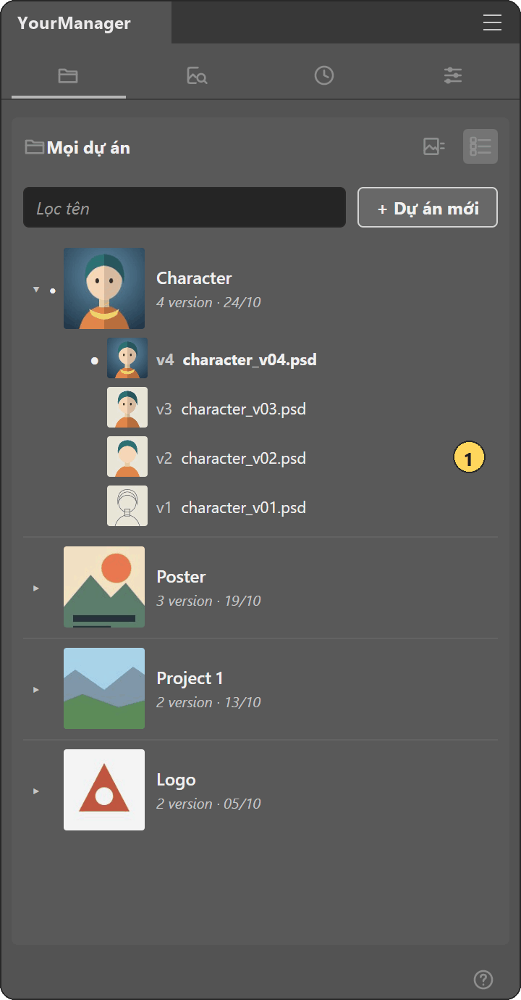

ảnh panel dựng từ trang thử, không phải ảnh chụp Photoshop

Mã dự án được lưu trong chính file PSD (phần thông tin file, không nằm ở tên). Khi panel gặp lại file - bạn mở nó, hoặc Tìm quét tới - dòng trong list đổi theo tên / chỗ mới. Bản chép được sửa riêng thành version riêng.

**Cách dùng**

1. Đổi tên hay dời PSD trong Windows Explorer tuỳ ý.
2. Mở nó trong Photoshop (hoặc **Quét lại ID** ở tab Tìm).
3. Dòng của nó ở **Dự án** hiện tên mới, vẫn dự án đó, vẫn version đó.

**Mẹo & giới hạn**

- Tới lúc panel gặp lại file, dòng của nó hiện "(mất file)".
- File lưu trước khi cài YourManager sẽ có mã ở lần lưu kế tiếp.

### Tìm

Tìm file PSD gốc từ một ảnh hoặc một file PSD khác.

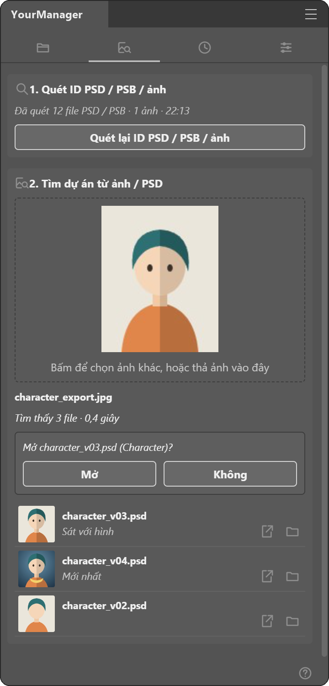

ảnh panel dựng từ trang thử, không phải ảnh chụp Photoshop

#### Tìm PSD / PSB dự án từ ảnh / PSD

*Thả một ảnh JPG / PNG đã xuất, ra ngay file PSD gốc - và version mới nhất của nó.*

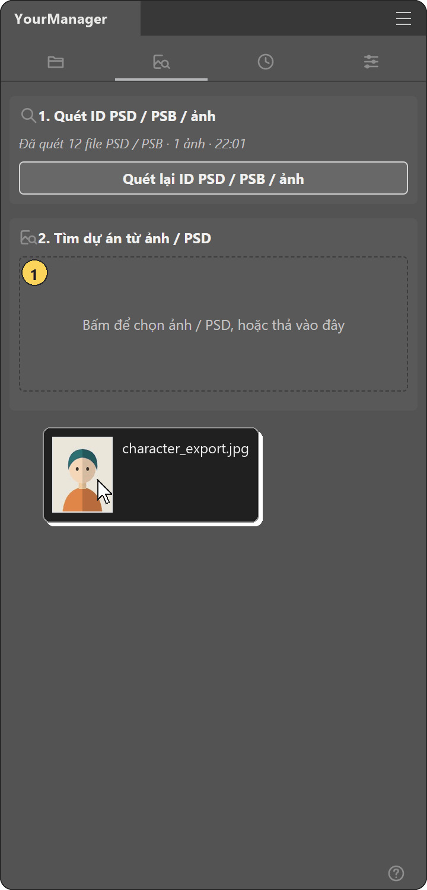

ảnh panel dựng từ trang thử, không phải ảnh chụp Photoshop

Tìm đọc ID của file PSD / PSB và ảnh trong các thư mục quét một lần, rồi tra bất kỳ ảnh hay PSD nào bạn thả vào. Kết quả có **Sát với hình** (PSD tạo ra ảnh đó) và **Mới nhất** (version trên cùng của dự án). Mở một file là panel nhảy tới dòng của nó ở tab Dự án.

**Cách dùng**

1. Ở tab **Tìm**, bấm **Quét ID PSD / PSB / ảnh** một lần (về sau nút thành **Quét lại ID**).
2. Thả ảnh hoặc PSD từ Explorer vào ô (hoặc bấm vào ô để chọn file).
3. Bấm **Mở** ở câu hỏi, hoặc icon mở ở một dòng kết quả.

**Tuỳ chọn**

- **Chuột phải một kết quả** - mở file, mở thư mục, chép đường dẫn; file chưa thuộc dự án nào thì thêm được vào dự án.
- **Cài đặt > Thư mục & loại file quét** - đọc những thư mục nào, loại file nào (PSD / PSB, ảnh, smart object).

**Mẹo & giới hạn**

- Lần quét đầu mất vài phút; quét lại chỉ vài giây (khoảng 3 s cho ~900 file PSD trên máy thử). File bị dời được nhận lại mà không đọc lại.
- Chuẩn nhất với ảnh xuất từ Photoshop (còn giữ ID). Ảnh mất ID thì so theo hình, kém chắc hơn.
- Tìm không khoá Photoshop: chạy trong một chương trình nhỏ riêng trên máy.

### Lịch sử

Hoàn tác / làm lại từng bước plugin đã làm.

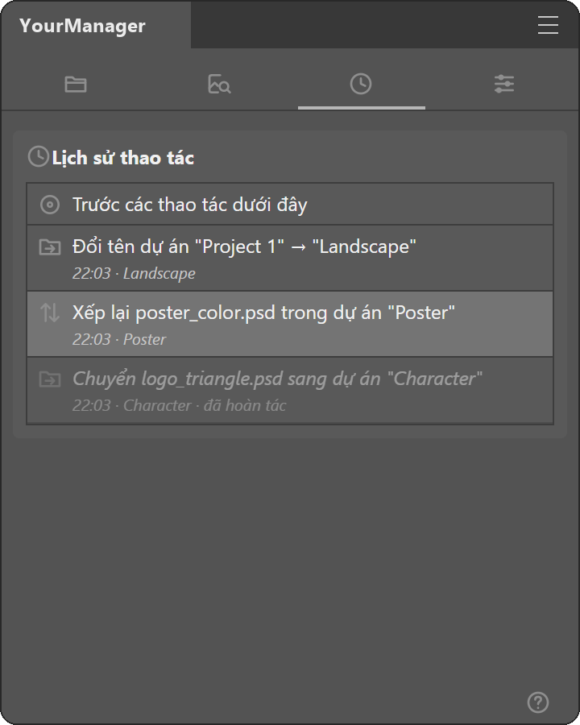

ảnh panel dựng từ trang thử, không phải ảnh chụp Photoshop

#### Lịch sử thao tác

*Đổi ý? Bấm một bước bất kỳ để quay về đó.*

Mỗi thay đổi plugin làm - xếp lại, đổi tên, dời file, đổi dự án - là một dòng ở đây, mới nhất ở dưới. Giữ 50 bước gần nhất.

**Cách dùng**

1. Mở tab **Lịch sử**.
2. Bấm một dòng để quay về ngay sau bước đó.
3. Bấm dòng mờ (đã hoàn tác) để làm lại.

**Mẹo & giới hạn**

- Xoá file thì không hoàn tác ở đây được: lấy lại trong Thùng rác của Windows.

### Cài đặt

Thư mục quét, loại file, câu hỏi khi lưu, ngôn ngữ, làm mới dữ liệu.

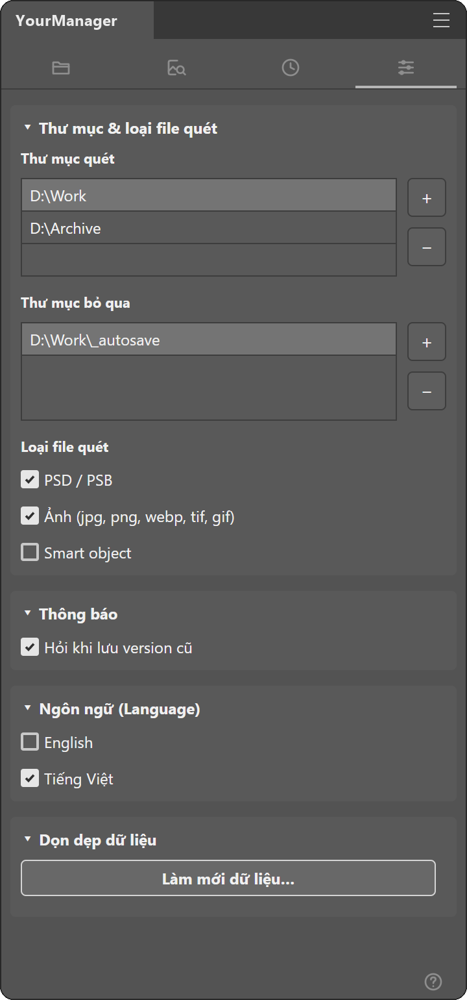

ảnh panel dựng từ trang thử, không phải ảnh chụp Photoshop

#### Cài đặt

*Chọn quét gì, ngôn ngữ panel, và làm mới dữ liệu khi cần.*

Bốn mục xổ ra được: **Thư mục & loại file quét**, **Thông báo**, **Ngôn ngữ (Language)**, **Dọn dẹp dữ liệu**.

**Tuỳ chọn**

- **Thư mục quét / Thư mục bỏ qua** - + / − hoặc thả thư mục từ Explorer. Thư mục chứa file của các dự án luôn được quét; thư mục hệ thống, cache thì không.
- **Loại file quét** - PSD / PSB, Ảnh (jpg, png, webp, tif, gif), Smart object (mặc định tắt; quét lâu thêm 1-3 phút).
- **Hỏi khi lưu version cũ** - xem bên dưới.
- **Ngôn ngữ (Language)** - English hoặc Tiếng Việt, áp ngay.
- **Làm mới dữ liệu…** - xoá dữ liệu quét cũ và quét lại từ đầu. Dùng khi Tìm cho kết quả lạ.

**Mẹo & giới hạn**

- Dữ liệu dự án nằm ở `%APPDATA%\YourManager`; xoá thư mục đó nếu muốn gỡ sạch.

#### Hỏi khi lưu version cũ

*Vừa lưu một version cũ? Một cú bấm là đưa nó lên trên cùng.*

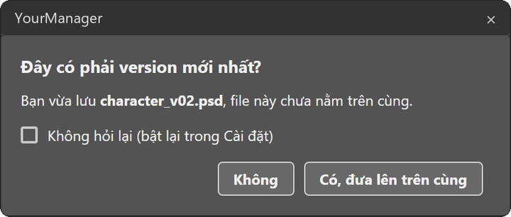

ảnh panel dựng từ trang thử, không phải ảnh chụp Photoshop

Khi bạn lưu (Ctrl+S, Save As, Save a Copy) một file không phải version trên cùng, plugin hỏi **Đây có phải version mới nhất?**

**Cách dùng**

1. Lưu một version không nằm trên cùng.
2. Bấm **Có, đưa lên trên cùng** - hoặc **Không** để giữ thứ tự.

**Mẹo & giới hạn**

- Tick **Không hỏi lại** để thôi hỏi; bật lại ở **Cài đặt > Thông báo**.

<a href="#top">lên đầu trang</a>

## Có gì mới

### PSArt 1.5.0

- Các công cụ nặng (Extract Lines, Separate to New Layer, Join line / Smooth Lines, Clean AI Image, Remove background) chạy ngầm, mỗi việc một thanh; vẫn vẽ tiếp được.

- Bố cục mới: tab icon, mỗi công cụ một khung, ô Help mở ngay dưới chỗ rê chuột (nút ? để tắt).

  

- Tên dễ hiểu hơn: Layer Tools, Separate to New Layer, Export & Replace, Extract Lines, Smooth Lines, Smooth Color Lines, Curved (2 VP).

- Select chuyển sang tab Lineart. ([→](#psart-selectcard))

- Tab Codex dùng như một trang chat. ([→](#psart-codex))

- Esc dừng sạch; các ô chọn layer nhớ theo từng file.

### YourManager 0.3.2

- Tìm không cần Python nữa: chương trình tìm ảnh có sẵn trong plugin. ([→](#ym-find))

- Không thuộc dự án này chuyển các file đang chọn sang dự án mới. ([→](#ym-projects))

- Ảnh dự án theo version trên cùng. ([→](#ym-projects))

- Kết quả tìm gọn hơn: một dòng **Sát với hình**, bản mới nhất **Mới nhất**. ([→](#ym-find))

  

- Cài đặt > Dọn dẹp dữ liệu: một nút **Làm mới dữ liệu…**. ([→](#ym-settings))

## Hỏi đáp

<b>Có chạy trên macOS không?</b>

Chưa. Cả hai plugin mới chỉ được làm và thử trên Windows.

<b>Tranh của tôi có bị gửi đi đâu không?</b>

Các công cụ vẽ của PSArt và YourManager chỉ chạy trên máy bạn. Chỉ tab Codex của PSArt gửi dữ liệu ra ngoài: tin nhắn và vùng chọn bạn bấm gửi, tới Codex bằng tài khoản ChatGPT của chính bạn.

<b>Bị lỗi thì gửi gì?</b>

Dòng chữ ở cuối panel, phiên bản Photoshop và bạn vừa bấm gì.

<b>PSArt hỏi quyền chạy start_bridge.vbs, có cần không?</b>

Chỉ tab Codex cần. Không dùng Codex thì bấm Deny, các tab khác vẫn chạy bình thường.

<b>YourManager có sửa file PSD của tôi không?</b>

Nó chỉ thêm một mã dự án nhỏ vào phần thông tin file (XMP) lúc bạn lưu. Layer và điểm ảnh không bị đụng tới.

## Liên hệ
Đây là bản thử cho bạn bè. Báo lỗi hay góp ý ở [Issues](https://github.com/DanhBoo/psart-plugin/issues) hoặc nhắn trực tiếp cho tác giả.
